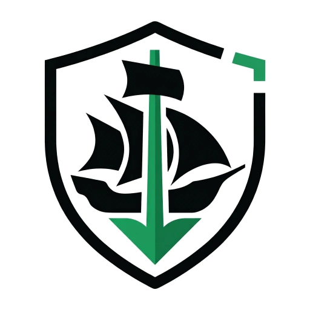
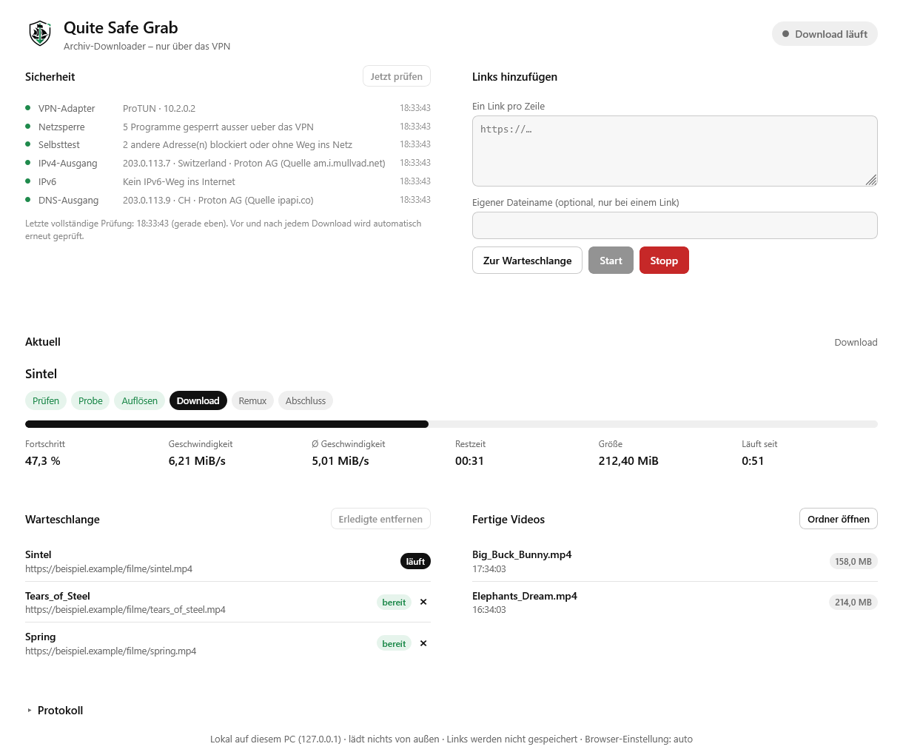
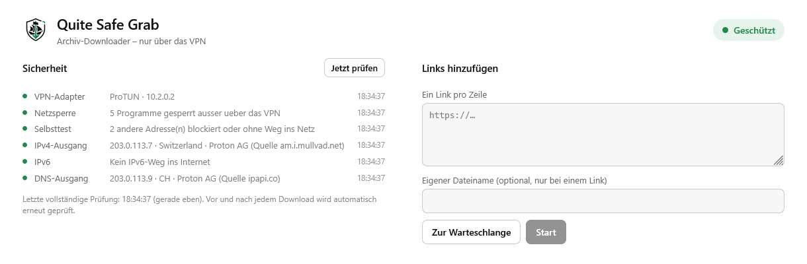
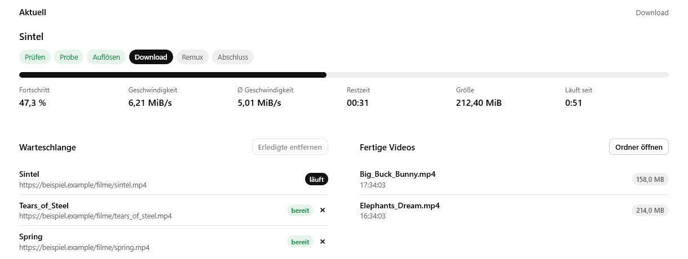

<p align="center"></p>

# Quite Safe Grab

**Videos sichern. Nur, wenn dein VPN wirklich schützt.**

  



<br>

## Was ist Quite Safe Grab?

Ein Programm für Windows, das Videos aus dem Internet auf deinem PC speichert.
Bevor es etwas lädt, prüft es jedes Mal, ob dein VPN aktiv ist. Ein VPN ist ein Dienst, der deine Verbindung verschlüsselt und deine Adresse verbirgt.
Ist der Schutz nicht da, lädt es nichts – *quite safe*: ziemlich sicher, aber ehrlich nie hundertprozentig.

> Lade nur Videos, die du laden darfst – zum Beispiel frei lizenzierte Filme oder eigene Aufnahmen.

<br>

## Was du brauchst

1. **Einen PC mit Windows 10 oder Windows 11** (64 Bit).
   Wo bekomme ich das? Das hast du schon, wenn dein PC in den letzten Jahren gekauft wurde.

2. **Proton VPN** mit einem Konto (die kostenlose Version reicht).
   Wo bekomme ich das? [protonvpn.com/download](https://protonvpn.com/download) – installieren und einmal anmelden.

3. **Eine Internetverbindung** für die Einrichtung (etwa 130 MB werden geladen).

4. **Empfohlen: den Mullvad Browser.** Ein Browser ist das Programm, mit dem du Webseiten ansiehst. Quite Safe Grab zeigt sich darin, ohne Spuren zu hinterlassen. Ohne ihn nimmt es Microsoft Edge.
   Wo bekomme ich das? [mullvad.net/browser](https://mullvad.net/browser)

<br>

## Installation in 5 Schritten

### 1. Herunterladen

Öffne die Seite [Releases](../../releases/latest) und klicke unter **Assets** auf die Datei `QuiteSafeGrab-Windows-[Version].zip`.

Du siehst jetzt die Datei in deinem Ordner **Downloads**.

### 2. Freigeben

Klicke mit der **rechten** Maustaste auf die Datei → **Eigenschaften**. Setze unten den Haken bei **Zulassen** → **OK**.

Du siehst jetzt keinen Unterschied – aber Windows warnt später nicht bei jedem Schritt.

### 3. Entpacken

Klicke mit der rechten Maustaste auf die Datei → **Alle extrahieren…** Tippe als Ziel ein:

```
C:\Tools
```

Klicke auf **Extrahieren**.

Du siehst jetzt einen Ordner `QuiteSafeGrab-Windows-[Version]` mit mehreren Dateien.

### 4. Einrichtung starten

Öffne Proton VPN und klicke auf **Verbinden**. Doppelklicke dann im neuen Ordner auf **`Einrichten.cmd`**.

Du siehst jetzt ein schwarzes Fenster. Es lädt zwei Hilfsprogramme und zeigt dabei einen Balken mit dem Fortschritt.

> Meldet Windows „Der Computer wurde durch Windows geschützt“: Klicke auf **Weitere Informationen** → **Trotzdem ausführen**.

### 5. Zwei Fragen beantworten

Das Fenster fragt nach deinem **Heimatland** und dem **Ordner für deine Videos**. Drücke jeweils **Enter**, um den Vorschlag zu übernehmen. Proton VPN und den Browser erkennt es von selbst.

Danach richtet es den **Schutz** ein – eine Regel in der Windows-Firewall, die das Programm nur durch das VPN ins Internet lässt. Drücke **Enter**. Windows fragt nach Erlaubnis: Klicke **Ja**. Ein zweites Fenster öffnet sich, arbeitet einige Sekunden, zeigt **FERTIG** und schließt sich von selbst – bitte dort nichts drücken.

Du siehst jetzt **„Fertig – Quite Safe Grab ist eingerichtet.“** und auf Wunsch eine Verknüpfung mit dem Logo auf deinem Desktop.

<br>

## So benutzt du es

**1. Verbinde Proton VPN.**

**2. Doppelklicke auf dem Desktop auf „Quite Safe Grab“.**
Es öffnet sich ein Browserfenster. Das Programm prüft kurz deine Verbindung – nach etwa 20 Sekunden steht oben rechts **„Geschützt“**.



**3. Füge Links ein und klicke auf „Start“.**
Ein Link pro Zeile → **Zur Warteschlange**. Die Titel erscheinen von selbst in der Liste. Dann **Start**.
Vor jedem Video prüft das Programm erneut die Verbindung – ein kleines Symbol zeigt, dass es arbeitet. Danach siehst du Fortschritt, Geschwindigkeit und Restzeit.



**4. Fertig.** Deine Videos liegen im Ordner aus Schritt 5 – ein Klick auf **Ordner öffnen** bringt dich hin.

Das schwarze Fenster bleibt offen, solange du das Programm benutzt. Schließt du das Browserfenster, beendet sich alles von selbst.

**Aktualisieren:** Starte **`Einrichten.cmd`** noch einmal. Es sucht eine neue Version und spielt sie ein – deine Einstellungen und Videos bleiben erhalten.

<br>

## Hilfe bei Problemen

**Oben steht „Gesperrt – Problem gefunden“.**
Dein VPN ist nicht verbunden oder gerade unterbrochen. Verbinde Proton VPN und klicke auf **Jetzt prüfen**.

**Beim Start erscheint „Netzsperre fehlt“ oder ein Download bricht sofort ab.**
Der Schutz passt nicht mehr – zum Beispiel, weil du den Ordner verschoben hast oder sich in Proton etwas geändert hat. Verbinde Proton VPN und starte **`Einrichten.cmd`** noch einmal – es repariert das.

**Ein Link zeigt „Fehler“ statt eines Titels.**
Das Video gibt es nicht mehr, oder die Seite hat ihre Adresse geändert. Prüfe den Link im Browser. Klappt er dort, schreib uns – siehe Kontakt.

Weitere Details für Fortgeschrittene: [docs/TECHNIK.md](docs/TECHNIK.md)

<br>

## Lizenz und Kontakt

GPL-3.0 – siehe [LICENSE](LICENSE). Fragen und Fehler: [GitHub Issues](../../issues)
